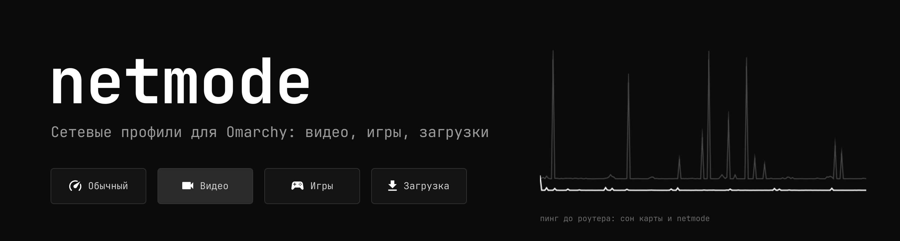
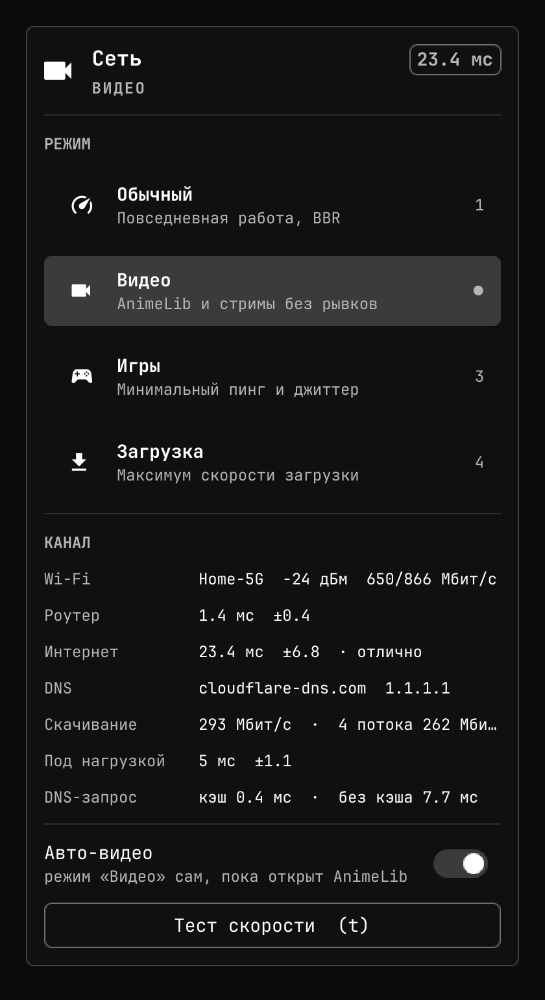
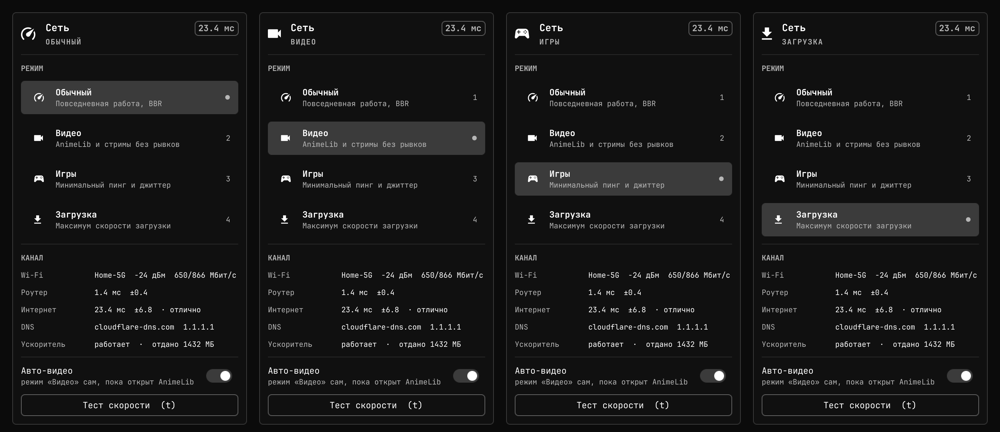
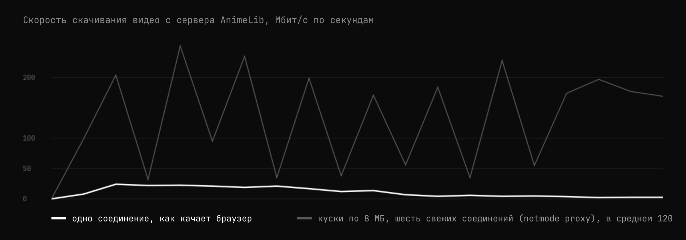
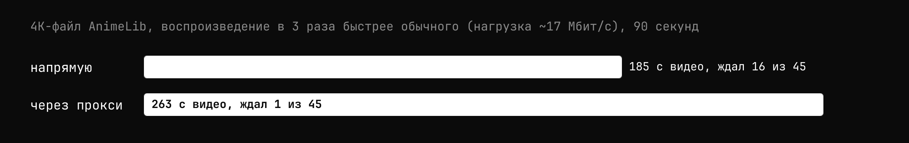
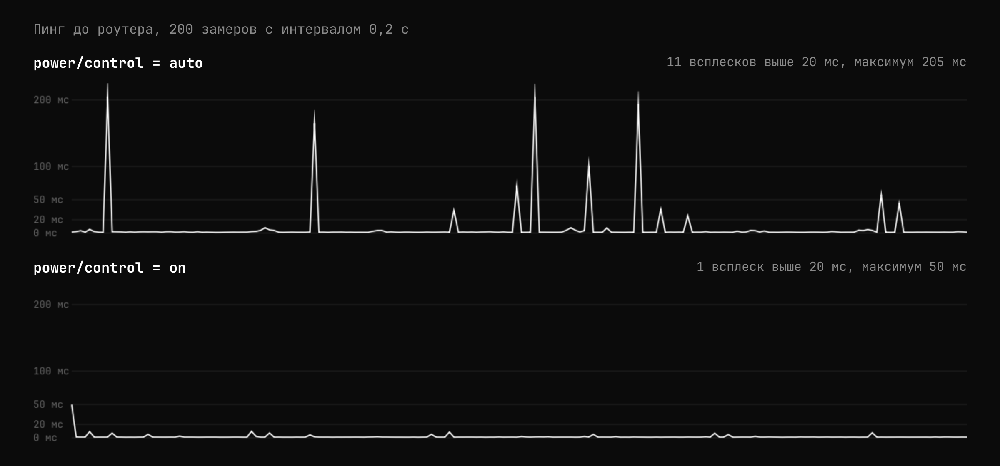

<p align="center">
  
</p>

Сетевые профили для [Omarchy](https://omarchy.org). Одна кнопка в панели
переключает настройки сети под задачу: видео в браузере, игры, большие
загрузки. Пинг всегда на виду, а когда в Chromium открыт AnimeLib, режим
«Видео» включается сам и выключается, когда вкладку закрыли.

<p align="center">
  
</p>

Видео в 4K на AnimeLib подвисало при быстром интернете. Нашлись две
причины. Сервер видео режет скорость каждого соединения примерно через десять
секунд, а браузер качает файл одним долгим соединением. Кроме того, простаивающая
карта Wi-Fi засыпает, и первый пакет после паузы ждёт до 200 мс. Против
первого есть локальный ускоритель, против второго настройка питания карты.
Замеры ниже.

## Что умеет

- **Четыре режима.** Обычный, Видео, Игры, Загрузка. Переключение из
  карточки, клавишами 1–4, средним кликом по виджету (по кругу) или
  командой `netmode set`.
- **Пинг в панели.** Значок активного режима и задержка до 1.1.1.1,
  обновляется каждые 12 секунд.
- **Авто-видео.** Следит за окнами Hyprland. Если в заголовке окна
  браузера есть «AnimeLib» или «Anilib», включается «Видео»; когда окно
  закрыто, возвращается прежний режим. Если вручную выбрать другой режим,
  netmode не спорит, пока окно не закроется.
- **Ускоритель видео.** Локальный прокси и расширение для Chromium: запросы
  к видеосерверам AnimeLib идут через `127.0.0.1`, а прокси забирает файл
  короткими кусками по шесть свежих соединений. Подробнее в разделе
  «Почему видео подвисает».
- **Тест скорости.** Задержка до роутера и в интернет, джиттер, DNS с
  кэшем и без, скачивание в один и в четыре потока, пинг под нагрузкой.
- **Загрузка в несколько соединений.** `netmode get` качает файл кусками
  параллельно. Если провайдер режет скорость одного соединения, выигрыш
  в разы.
- **Без демонов с правами root.** Привилегированная часть — один скрипт,
  который умеет только переключать четыре заранее заданных режима.

<p align="center">
  
</p>

В панели виджет выглядит так: значок режима и пинг в миллисекундах.

<p align="center">
  
</p>

Цвета, шрифт и скругления берутся из текущей темы Omarchy.

## Установка

Нужен Omarchy 4 (панель на Quickshell).

```bash
git clone https://github.com/NOXQD/netmode.git
cd netmode
./install.sh
```

Скрипт один раз спросит пароль root и ставит:

- `/usr/local/lib/netmode/netmode-root`, помощник с правами root. Менять его
  может только root;
- правило sudoers на четыре команды `netmode-root apply <режим>`, ничего
  другого оно не разрешает;
- юнит `netmode-boot.service`: после перезагрузки настройки ядра
  сбрасываются, юнит возвращает режим «Обычный»;
- `~/.local/bin/netmode`, плагин `noxqd.netmode` для панели и пользовательские
  сервисы: `netmode-watch` (авто-видео) и `netmode-proxy` (ускоритель);
- расширение Chromium в `~/.local/share/netmode/extension`: путь дописывается в
  `--load-extension` в `~/.config/chromium-flags.conf` (копия файла лежит
  рядом с суффиксом `.netmode-bak`).

В конце перезапускается оболочка, чтобы появился виджет. **Chromium нужно один
раз перезапустить**, флаги он читает при старте; на значке расширения будет
надпись `on`. Повторный запуск
обновляет установленное. Без root можно поставить только пользовательскую
часть: `./install.sh --no-root` (режимы тогда переключаться не будут, но
`netmode keepalive`, `bench` и `get` работают).

Убрать всё: `./uninstall.sh` (с `--purge` заодно конфиг и сохранённые замеры).

## Режимы

| Режим | Что меняется |
|---|---|
| Обычный | BBR и fq. Карта Wi-Fi не засыпает, пока ноутбук в розетке, на батарее остаётся `auto` |
| Видео | то же всегда, плюс окна приёма до 64 МБ и увеличенные очереди |
| Игры | карта не спит, `busy_poll`, короткая очередь отправки (`tcp_notsent_lowat`) |
| Загрузка | окна до 128 МБ, увеличенные очереди приёма |

Все значения лежат в таблице `MODES` в [root/netmode-root](root/netmode-root),
другого источника нет. Режим применяется целиком: переключение не оставляет
хвостов от предыдущего.

Честно про эффект: настройки TCP влияют на скорость скачивания меньше, чем
кажется. Это в основном настройки отправителя, а при просмотре видео
отправитель — чужой сервер. На практике заметнее всего работают две вещи:
карта Wi-Fi, которая не засыпает, и несколько соединений для загрузок.

## Почему видео подвисает

Файлы AnimeLib (`video1.cdnlibs.org`, `video2.cdnlibs.org`) отдаются обычными
MP4 по Range-запросам. Сервер даёт новому соединению быстрый старт, десятки
Мбит/с на первые 10 секунд, а потом режет его до 3–6 Мбит/с. Новое
соединение снова стартует быстро, это проверено отдельным тестом: второе
соединение, запущенное, когда первое уже «остыло», сразу получало 40–67 Мбит/с.

<p align="center">
  
</p>

4K-файл серии (H.264, 3840×2160, 24 к/с) весит около гигабайта, в среднем это
5,6 Мбит/с, но в динамичных сценах, драках и резких сменах кадра, битрейт
доходит до 28 Мбит/с, а десять секунд подряд бывают на 25. Браузер читает
файл одним соединением, после первых секунд получает 3–6 Мбит/с и на таких
сценах упирается в пустой буфер. Декодер тут ни при чём: самые тяжёлые 30
секунд серии ffmpeg разбирает за 6–7 секунд.

`netmode proxy` слушает только `127.0.0.1:18765` и отвечает плееру как обычный
сервер с Range. Сам он забирает нужные байты с сервера кусками до 8 МБ, по
шесть одновременно, каждый на новом соединении. Первый кусок маленький
(1 МБ), чтобы воспроизведение начиналось быстро, а запрос размера файла
совмещён с этим куском. Дальше прокси не ждёт, пока плеер попросит следующие байты: он докачивает
файл вперёд на 160 МБ от того места, где сейчас читает плеер, и держит это в
памяти. Это больше четырёх минут обычного видео или около минуты самых
тяжёлых сцен, так что скачок битрейта или провал в сети уходит в буфер, а
Chromium получает данные из памяти. Перемотка в уже скачанное место отдаётся
мгновенно. Если соединение для куска оказалось медленным, оно сбрасывается и
кусок запрашивается заново; когда плеер уходит (например, перемотал), остальная
подгрузка отменяется. Расширение
`extension/` перенаправляет запросы страницы к `video*.cdnlibs.org` на этот
прокси, но только пока прокси отвечает на `/ping`, поэтому остановленный
прокси ничего не ломает.

Проверка в отдельном Chromium (чистый профиль, тот же 4K-файл, воспроизведение
в 3 раза быстрее обычного, чтобы нагрузка превышала скорость остывшего
соединения; через прокси со 160 МБ запаса):

<p align="center">
  
</p>

При обычной скорости воспроизведения и в начале серии браузер справляется и
сам: короткие тесты на 40–160 секунд в начале файла напрямую не буксовали. Выигрыш
появляется, когда запрос превышает то, что даёт одно остывшее соединение:
долгий просмотр, динамичные сцены, перемотка вперёд.

## Карта Wi-Fi и всплески задержки

Сигнал отличный, а пинг до роутера в простое выглядит так:

<p align="center">
  
</p>

Причина в управлении питанием PCI-устройства: при `power/control=auto` карта
уходит в сон между пакетами. Верхний график снят в этом состоянии (11 пингов
из 200 дольше 20 мс, максимум 205), нижний при `on` (один пинг, максимум 50).
Во время загрузки пинг ровный, потому что трафик не даёт карте заснуть, а в
паузах между кусками видео получается хуже всего.

`netmode keepalive` решает ту же задачу без root: шлёт один байт UDP на
роутер 100 раз в секунду (около 6 КБ/с). Меньшая частота помогает хуже, см.
[docs/MEASUREMENTS.md](docs/MEASUREMENTS.md).

## Несколько соединений

У провайдера, на котором всё это снималось, скорость одного соединения
режется сильнее, чем скорость нескольких. Один и тот же файл:

<p align="center">
  
</p>

```bash
netmode get https://example.com/big.iso -n 16
```

Файл режется на куски, каждый тянется своим соединением, всё пишется в
`.part` и переименовывается по окончании. Если сервер не отдаёт диапазоны,
качает одним потоком. Браузерный плеер так не умеет, это пригождается для
скачивания, `yt-dlp` с `-N` делает то же самое.

## Команды

```
netmode                  режим и состояние канала
netmode set video        переключить режим (balanced, video, gaming, download)
netmode modes            список режимов
netmode bench            замер: DNS, задержка, джиттер, скорость
netmode get URL -n 16    загрузка в несколько соединений
netmode proxy            ускоритель видео (обычно запущен как сервис)
netmode keepalive        не давать Wi-Fi засыпать без root (Ctrl-C чтобы остановить)
netmode auto on|off      авто-видео
netmode watch            демон авто-видео (запускается юнитом)
```

Клавиши в карточке: `1`–`4` выбрать режим, `a` авто-видео, `t` тест скорости,
`Esc` закрыть. Для биндов в Hyprland есть IPC:
`omarchy-shell netmode cycle` и `omarchy-shell netmode set video`.

## Настройка

`~/.config/netmode/config.json`, все ключи необязательны:

```json
{
  "auto_video": true,
  "patterns": ["anime\\s?lib", "anilib"],
  "browsers": ["chromium", "chrome", "brave", "vivaldi", "firefox", "zen", "opera"],
  "proxy_port": 18765,
  "proxy_ahead_mb": 160,
  "proxy_hosts": ["^video\\d*\\.cdnlibs\\.org$"]
}
```

`patterns` — регулярные выражения для заголовка окна. Чтобы авто-видео
срабатывало на другом сайте, добавьте его название. `proxy_hosts` ограничивает,
какие серверы прокси вообще согласен обслуживать. `proxy_ahead_mb` задаёт размер запаса вперёд, прокси в пике занимает вдвое больше памяти. Порт в `extension/background.js`
задан отдельно, при смене порта поправьте и его.

## Безопасность

Помощник с правами root принимает ровно одно из четырёх имён режимов и
ничего больше: путей, значений и команд от вызывающего он не читает. Правило
sudoers перечисляет эти четыре вызова, а не маску. Все значения, которые
записываются в ядро, зашиты в самом скрипте. Он не меняет ни DNS, ни
правила firewall, ни конфиги NetworkManager.

Ускоритель работает без прав root и слушает только loopback. Обслуживает
только серверы из `proxy_hosts` (остальным отвечает 403), так что через него
нельзя ходить на произвольные адреса. Расширению нужен доступ к
`*.cdnlibs.org`, `animelib.org` и `anilib.me`; других сайтов оно не трогает.

## Тесты

```bash
python3 -m unittest discover -s tests
```

Проверяются таблица режимов, отказ помощника от неизвестных аргументов,
загрузка кусками (с сервером, который отдаёт диапазоны, и с таким, который не
отдаёт), разбор окон для авто-видео и прокси: целый файл, открытые, закрытые и
суффиксные диапазоны, HEAD, 416, чужие хосты, замена зависшего соединения и
кэш в памяти (повторное чтение без обращения к серверу, подгрузка вперёд).

## Лицензия

MIT
